# 12 Pillars — build your own life OS

<p>
<a href="https://mcp.johannsenlum.com/12-pillars#claude"></a>
<a href="https://mcp.johannsenlum.com/12-pillars#codex"></a>
</p>

A plugin for **Claude Code** and **Codex** (CLI and app) that turns your AI into a personal operating system. It understands your life through the **12-Pillar Life Flywheel**, remembers it with a **raw/wiki memory**, and organises everything into **twelve pillar folders** that together are your whole second brain: your studies, your job and your businesses included.

## The idea in three parts

**1. The 12-Pillar Life Flywheel.** Your life is one connected system, not twelve separate departments. Each pillar gives something to the next:

<p align="center"></p>

> Faith → direction · Identity → clarity · Time → allocation · Health → capacity · Development → skill · Relationships → access · Career → credibility · Brand → opportunity · Opportunities → finance · Finance → lifestyle · Lifestyle → legacy · Legacy → back to faith

When something is stuck, the cause is usually upstream of it. Start with the pillar that hurts most and let momentum carry the rest. The short map is in [`frameworks/12-pillars.md`](frameworks/12-pillars.md); the full method for each pillar (the 168-hour budget, seasons, gifting → stacking, FORM, deal cards, the four finance tiers, declarations and more) is in [`frameworks/pillar-playbook.md`](frameworks/pillar-playbook.md).

**2. A memory that compounds.** Based on Andrej Karpathy's [LLM wiki](https://gist.github.com/karpathy/442a6bf555914893e9891c11519de94f) pattern:
- `raw/` holds your sources: notes, voice notes, documents, screenshots. They're never edited.
- The twelve pillar folders hold the pages the AI writes and keeps cross-linked: who you are, your people, your health, your job, your goals.
- `AGENTS.md` holds the rules for how it's all organised (with a one-line `CLAUDE.md` pointing to it, so Claude Code and Codex read the same rules).

You share something once, and every relevant page stays current. See [`frameworks/llm-wiki.md`](frameworks/llm-wiki.md).

**3. The 12 pillars are the folders.** There is no separate "work" or "study" folder: everything lives in the pillar it belongs to. Your studies go in Development, your job in Career, each business in Opportunities, your investing in Finance, your posts in Brand. Setup starts with who you are (Identity), then asks what fills your days and gives each part its own small folder inside its pillar, sized to fit. Open a chat inside any pillar folder and it becomes that pillar's advisor. See [`frameworks/folder-design.md`](frameworks/folder-design.md).

## What your workspace looks like

```
your-workspace/
├── AGENTS.md            the rules (CLAUDE.md just imports it)
├── raw/                 your sources, never edited
├── index.md  log.md  actions.md   catalog, history, every deadline
├── 01-faith/
├── 02-identity/         who you are, north star, current season
├── 03-time/             168-hour budget, planning
├── 04-health/
├── 05-development/
│   └── nus/             your studies: courses/ exams/ projects/
├── 06-relationships/    people/ (one page each)
├── 07-career/
│   └── twiss/           your job: clients/ projects/
├── 08-brand/            posts/
├── 09-opportunities/
│   └── side-shop/       a business you run
├── 10-finance/
├── 11-lifestyle/
└── 12-legacy/
```

Every pillar folder has a README (where it stands, current focus, open questions). A student with a job and a side shop looks like the example above; someone between things just has the twelve pillars.

## Install

<p>
<a href="https://mcp.johannsenlum.com/12-pillars#claude"></a>
<a href="https://mcp.johannsenlum.com/12-pillars#codex"></a>
</p>

**One step (Mac / Linux).** Paste this into Terminal. It installs into Claude Code and/or Codex, whichever you have, and creates `~/my-life`:

```bash
curl -fsSL https://raw.githubusercontent.com/twiss-io/12-pillar-plugin/main/install.sh | bash
```

Prefer clicking through the apps, or on Windows? See the **[install guide](INSTALL.md)**. Manual commands are below.

### Claude Code

In a [Claude Code](https://claude.com/claude-code) session, run these **one at a time** (wait for each to finish):

```
/plugin marketplace add twiss-io/12-pillar-plugin
```
```
/plugin install 12-pillars@12-pillars
```

Optional: turn on auto-updates with `/plugin` → Manage marketplaces → 12-pillars → Enable auto-update.

Then create a personal folder, open Claude Code in it, and start setup:

```bash
mkdir -p ~/my-life && cd ~/my-life && claude
```
```
/12-pillars:setup
```

### Codex (CLI and app)

In a terminal, add the marketplace and install the plugin:

```bash
codex plugin marketplace add twiss-io/12-pillar-plugin
codex plugin add 12-pillars@12-pillars
```

In the **Codex app**, you can instead open **Plugins**, find **12 Pillars**, and install it there once the marketplace is added. Then start Codex in a personal folder and run setup:

```bash
mkdir -p ~/my-life && cd ~/my-life && codex
```
```
$12-pillars:setup
```

Codex asks you to review the plugin's two small hooks before they run. Open `/hooks` and trust them (see [How filing works](#how-filing-works)). Everything works without them; they just make filing more reliable in long sessions.

<p align="center"></p>

In a hurry? Pick **quick start** in setup (about five minutes: who you are and what fills your days). Whatever you skip fills in from normal conversation over time.

## Skills

In Claude Code, run a skill as `/12-pillars:<name>`. In Codex, type `$12-pillars:<name>` or pick it from `/skills`. Both can also start a skill on their own when what you ask matches it.

| Skill | What it does |
|---|---|
| `/12-pillars:setup` | Choose a **full setup** (~30–40 min: who you are and your vision, optional profiles, what fills your days, where you are now, then the pillar that matters most) or a **quick start** (~5 min: who you are and what fills your days). Whatever you don't set up is learned as you go. Resumable, and every question is skippable. |
| `/12-pillars:capture` | The daily habit. Tell it what happened or drop in a file. It proposes where it goes and what it updates, and files it after one confirm. You can also just talk; anything you share is treated as a capture. |
| `/12-pillars:wrap` | After a brainstorm or planning session: pulls out the decisions, ideas, and actions, and files them into the right pillar, or into your job, studies or a business inside it. Also offered automatically when a session winds down. |
| `/12-pillars:ask` | Ask anything. Answers come from your pillars, with links to the pages used. |
| `/12-pillars:dashboard` | Opens a dashboard of your life in the browser: the 12 pillars (click one to see everything in it), deadlines, your season, people and recent activity. Built from your own files, on your computer, and refreshed at the start of each session. |
| `/12-pillars:pillars` | Your 12 pillars at a glance, an optional 1–10 score, and the one pillar to work on next. |
| `/12-pillars:add-business` | Add your studies, your job, a business or investing as a folder inside its pillar, or grow an existing one with more sections. |
| `/12-pillars:lint` | Health check: contradictions, stale info, broken links, unprocessed sources, people you haven't been in touch with lately. `/12-pillars:lint rules` refreshes your workspace rules after a plugin update, and moves a workspace from before 0.8.0 into the pillar folders. |

## Updating

Updates don't reach you on their own unless you turn that on.

- **Easiest (Claude Code and Codex):** run the install line again. It updates whatever is already installed.
  ```bash
  curl -fsSL https://raw.githubusercontent.com/twiss-io/12-pillar-plugin/main/install.sh | bash
  ```
- **Claude Code, automatically:** `/plugin` → Manage marketplaces → 12-pillars → Enable auto-update. It then updates each time Claude Code starts.
- **Claude Code, by hand:** `claude plugin marketplace update 12-pillars`, then `claude plugin update 12-pillars@12-pillars`.
- **Codex, by hand:** `codex plugin marketplace upgrade 12-pillars`, then `codex plugin add 12-pillars@12-pillars`.

Restart any open Claude or Codex window afterwards. Skills and hooks update straight away. Your workspace rules (`AGENTS.md`) are your own copy, so an update never rewrites them. When the plugin ships newer rules, your next session mentions it, and `/12-pillars:lint rules` refreshes them after one confirm. Your notes, wiki and anything you added under `## My additions` stay as they are.

## How filing works

- **Life updates** ("closed a client today", "back's been bad all week") get filed right away, with one confirm.
- **Things you mention in passing** while asking for something else aren't filed mid-task. They're noted, and at a natural pause you get one card ("I picked up 2 things about you…") to file them all with one confirm. With the quick start, this is how your workspace fills in.
- **Brainstorms and planning sessions** aren't interrupted. When one winds down, you get a wrap-up card: what was decided, ideas parked, actions, open questions. One confirm files it. Next time you work on that business or project, the session starts from those decisions instead of from zero.
- Two small hooks keep this reliable. One re-states the filing convention on every message, so it holds through long sessions and context compaction. The other re-orients each new or compacted session with your current season and any files you dropped in but haven't filed yet. Both do nothing outside a 12-pillar workspace. Claude Code and Codex use the same hook format; in Codex, trust them once in `/hooks`.

## Optional profiles

Setup can keep an **astrology profile** (Chinese four-pillar chart, computed offline by a bundled script) and a **personality type** (Enneagram, through a short multiple-choice protocol). Both are entirely optional. You choose at the start, and everything works without them. They inform the AI quietly in the background and are shown whenever you ask. See [`frameworks/instruments.md`](frameworks/instruments.md).

## Privacy

- The plugin ships no personal data. Your workspace exists only on your machine.
- Setup writes a `.gitignore` that keeps every folder out of git (only the rules files are tracked), so your data stays out of git by default.
- The AI is instructed never to put workspace content into web searches, URLs, or external tools.
- Honest limit: your conversations go through your AI provider, the same as any Claude session.

## License

Apache License 2.0 © 2026 Twiss. Free to use, copy, modify and share, including commercially. Keep the copyright and [`NOTICE`](NOTICE) in copies, and mark files you change. It also includes a patent grant. See [`LICENSE`](LICENSE).

## Status

Version 0.8.0, early release. Feedback and issues welcome.
