# 12 Pillars — build your own life OS

A Claude Code plugin that turns your AI into a personal operating system. It understands your life through the **12-Pillar Life Flywheel**, remembers it with a **raw/wiki memory**, and organises your folders around **your** life and **your** businesses.

## The idea in three parts

**1. The 12-Pillar Life Flywheel.** Your life is one connected system, not twelve separate departments. Each pillar gives something to the next:

<p align="center"></p>

> Faith → direction · Identity → clarity · Time → allocation · Health → capacity · Development → skill · Relationships → access · Career → credibility · Brand → opportunity · Opportunities → finance · Finance → lifestyle · Lifestyle → legacy · Legacy → back to faith

When something is stuck, the cause is usually upstream of it. Start with the pillar that hurts most and let momentum carry the rest. The full guide is in [`frameworks/12-pillars.md`](frameworks/12-pillars.md).

**2. A memory that compounds.** Based on Andrej Karpathy's [LLM wiki](https://gist.github.com/karpathy/442a6bf555914893e9891c11519de94f) pattern:
- `raw/` holds your sources: notes, voice notes, documents, screenshots. They're never edited.
- `wiki/` holds pages the AI writes and keeps cross-linked: your pillars, people, topics, goals.
- `CLAUDE.md` holds the rules for how it's all organised.

You share something once, and every relevant page stays current. See [`frameworks/llm-wiki.md`](frameworks/llm-wiki.md).

**3. Folders designed for you.** Setup interviews you about your life and each business you run (what it does, your role, what it runs on) and **recommends** a structure. A side project gets one notes page. An agency gets clients, projects, proposals, and team. Nothing is created until you confirm. See [`frameworks/folder-design.md`](frameworks/folder-design.md).

## What your workspace looks like

```
your-workspace/
├── CLAUDE.md
├── life/                     you, organised by the 12 pillars
│   ├── raw/                  your sources (never edited)
│   └── wiki/
│       ├── index.md          catalog of every page
│       ├── log.md            history of every change
│       ├── self/             your vision, where you are now, optional profiles
│       ├── pillars/          12 hub pages, 01-faith … 12-legacy
│       ├── people/
│       └── topics/
└── businesses/
    ├── my-agency/            Deep: raw/ + wiki/ with clients/ projects/ team/
    ├── my-product/           Standard: raw/ + wiki/ with product/ decisions/
    └── side-shop/            Light: notes.md
```

## Install

You need [Claude Code](https://claude.com/claude-code). In a Claude Code session, run these **one at a time** (wait for each to finish):

```
/plugin marketplace add twiss-io/12-pillar-plugin
```
```
/plugin install 12-pillars@12-pillars
```

Optional: turn on auto-updates with `/plugin` → Manage marketplaces → 12-pillars → Enable auto-update.

Then create a personal folder, open Claude Code in it, and start setup:

```bash
mkdir -p ~/my-life && cd ~/my-life && claude
```
```
/12-pillars:setup
```

<p align="center"></p>

In a hurry? Pick **quick start** (about two minutes) or **choose parts** in setup. Whatever you skip fills in from normal conversation over time.

## Commands

| Command | What it does |
|---|---|
| `/12-pillars:setup` | Choose a **full setup** (~45 min guided interview: about you, optional profiles, your vision, where you are now, your businesses with a recommended folder structure, then the pillar that matters most), **only the parts you pick**, or a **quick start** (~2 min). Whatever you don't set up is learned as you go. Resumable, and every question is skippable. |
| `/12-pillars:capture` | The daily habit. Tell it what happened or drop in a file. It proposes where it goes and what it updates, and files it after one confirm. You can also just talk; anything you share is treated as a capture. |
| `/12-pillars:wrap` | After a brainstorm or planning session: pulls out the decisions, ideas, and actions, and files them into the right business (or your life wiki). Also offered automatically when a session winds down. |
| `/12-pillars:ask` | Ask anything. Answers come from your wiki, with links to the pages used. |
| `/12-pillars:pillars` | Your 12 pillars at a glance, an optional 1–10 score, and the one pillar to work on next. |
| `/12-pillars:add-business` | Add a business, or upgrade a light one, with a recommended structure. |
| `/12-pillars:lint` | Health check: contradictions, stale info, broken links, unprocessed sources, people you haven't been in touch with lately. |

## How filing works

- **Life updates** ("closed a client today", "back's been bad all week") get filed right away, with one confirm.
- **Things you mention in passing** while asking for something else aren't filed mid-task. They're noted, and at a natural pause you get one card ("I picked up 2 things about you…") to file them all with one confirm. With the quick start, this is how your workspace fills in.
- **Brainstorms and planning sessions** aren't interrupted. When one winds down, you get a wrap-up card: what was decided, ideas parked, actions, open questions. One confirm files it. Next time you work on that business, the session starts from those decisions instead of from zero.
- Two small hooks keep this reliable. One re-states the filing convention on every message, so it holds through long sessions and context compaction. The other re-orients each new or compacted session with your current season and any files you dropped in but haven't filed yet. Both do nothing outside a 12-pillar workspace.

## Optional profiles

Setup can keep an **astrology profile** (Chinese four-pillar chart, computed offline by a bundled script) and a **personality type** (Enneagram, through a short multiple-choice protocol). Both are entirely optional. You choose at the start, and everything works without them. They inform the AI quietly in the background and are shown whenever you ask. See [`frameworks/instruments.md`](frameworks/instruments.md).

## Privacy

- The plugin ships no personal data. Your workspace exists only on your machine.
- Setup writes a `.gitignore` covering `life/` and `businesses/`, so your data stays out of git by default.
- The AI is instructed never to put workspace content into web searches, URLs, or external tools.
- Honest limit: your conversations go through your AI provider, the same as any Claude session.

## License

MIT © 2026 Twiss / Torch Labs. Free to use, copy, modify and share, including commercially. Keep the copyright notice in copies. See [`LICENSE`](LICENSE).

## Status

Version 0.3.1, early release. Feedback and issues welcome.
